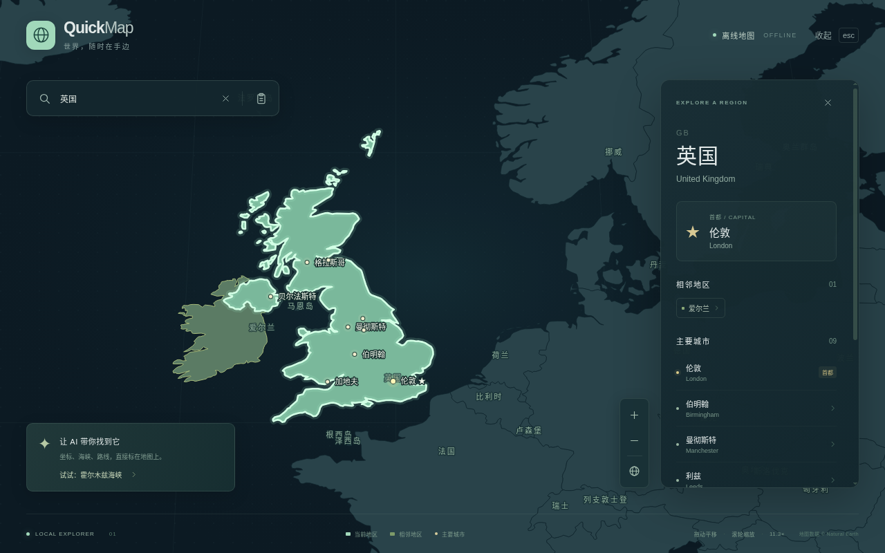
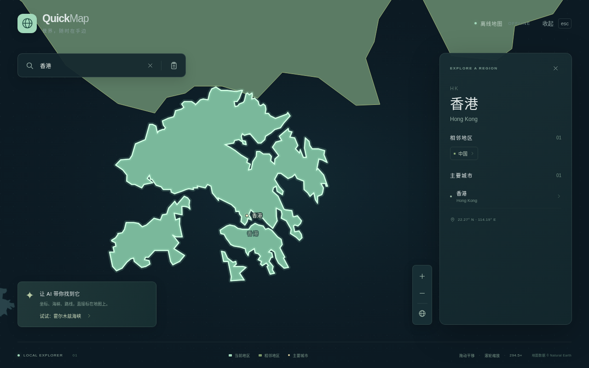
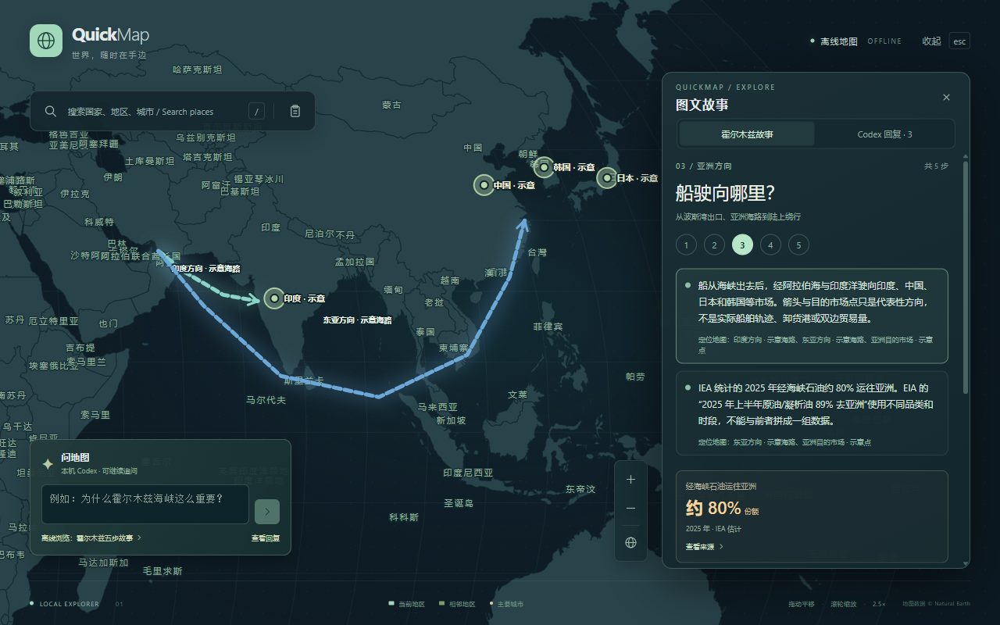
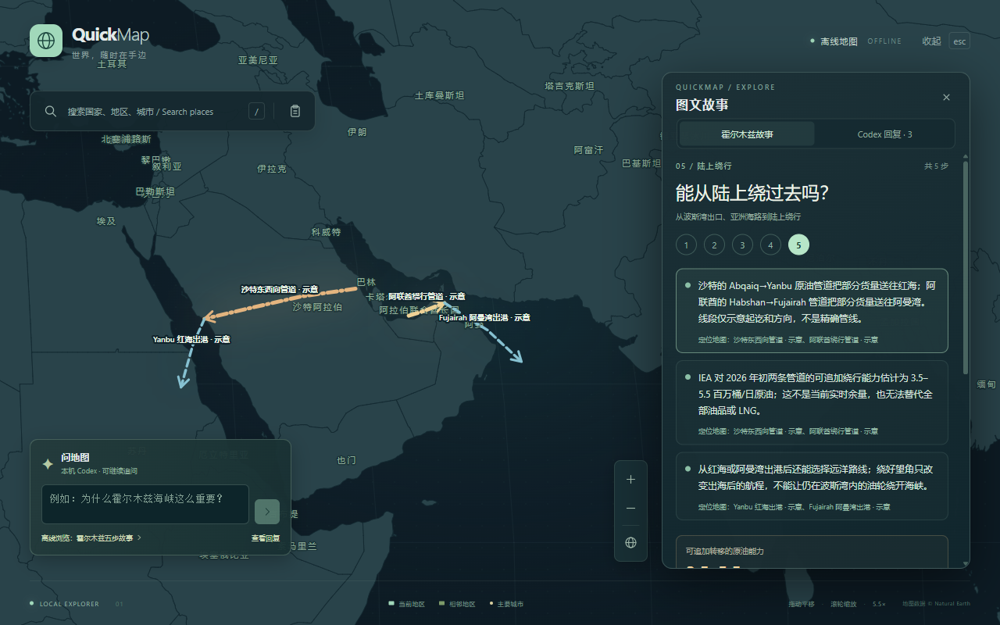
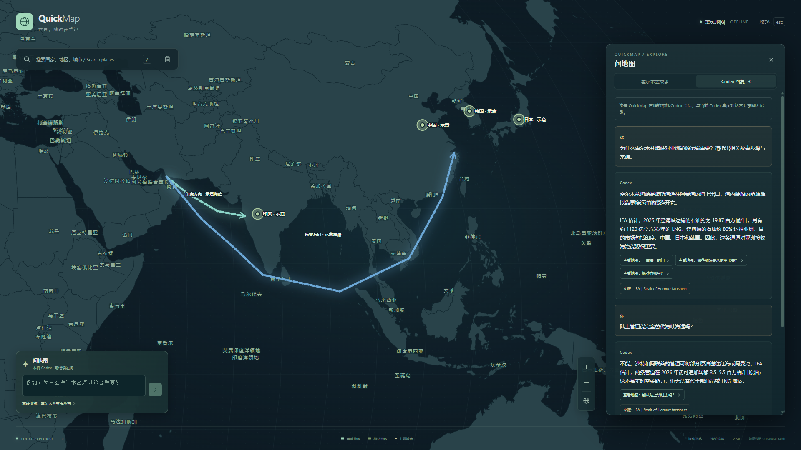

# QuickMap

QuickMap is a Windows desktop world map that opens with a global shortcut. It works offline for country and major city browsing, and exposes local commands so Codex or another AI can mark places that are absent from the built-in map data.

## Windows 快速开始

1. 在 [Windows package 构建记录](https://github.com/Zhangsfish/QuickMap/actions/workflows/windows-package.yml)中打开最近一次成功运行，下载 `QuickMap-win32-x64`，解压后运行 `QuickMap.exe`。它是便携版，无需安装 Node.js。
2. 按 **Ctrl+Alt+M** 唤出地图，按 **Esc** 收起。搜索框可查国家和主要城市；遇到海峡、岛屿等未收录地点，可让本地 AI 临时标注。
   地图左下角的「问地图」输入框目前是**霍尔木兹故事问答预览版**，可向本机 Codex 提问、继续追问或取消回复；下方的「离线浏览：霍尔木兹五步故事」无需 Codex 或网络即可使用。地图内会话由 QuickMap 单独管理，不共享当前 Codex 桌面对话记录。开放式问题与地图联动的下一版需求见 [Issue #3](https://github.com/Zhangsfish/QuickMap/issues/3)。
3. 在运行 Codex 的 Windows 终端注册地图工具，路径换成你实际解压的位置：

   ```powershell
   codex mcp add quickmap --env ELECTRON_RUN_AS_NODE=1 -- "C:\Apps\QuickMap-win32-x64\QuickMap.exe" "C:\Apps\QuickMap-win32-x64\control\mcp.cjs"
   ```

   保持 `QuickMap.exe` 运行，并重新打开一个 Codex 会话。可以直接问“英国在哪？”或“香港在哪？”。AI 可调用 `focus_region`，地图会放大该地区、加粗并高亮现有边界。问“北方四岛在哪里？请在 QuickMap 圈出来”或“霍尔木兹海峡在哪里？请在地图上标注”时，AI 可调用 `highlight_area` 画示意圈，或调用 `add_overlay` 画更精确的 GeoJSON 边界。圈的范围取决于 AI 提供的坐标，不能当作政治或法律边界。

   也可从 PowerShell 手动发命令，例如：

   ```powershell
   & "C:\Apps\QuickMap-win32-x64\control\quickmap.cmd" region 英国
   & "C:\Apps\QuickMap-win32-x64\control\quickmap.cmd" story-step hormuz-1
   & "C:\Apps\QuickMap-win32-x64\control\quickmap.cmd" circle northern-islands "北方四岛" 146.5 44.5 250
   ```

## 效果预览

| 英国边界高亮 | 香港边界高亮（10m 数据） |
| --- | --- |
|  |  |

| 五步故事：亚洲方向 | 五步故事：陆上绕行 | 地图内 Codex 回复与追问 |
| --- | --- | --- |
|  |  |  |

## Run it

For source development, use Node.js 24 or newer. From this repository:

```sh
npm ci
npm run build
npm start
```

On Windows, `npm run dev:desktop` starts the Vite renderer and Electron together. `npm run dev:web` starts only the browser map for UI work. `npm test` checks the local control protocol, MCP tools, and Codex bridge. `npm run package:win` creates `release/QuickMap-win32-x64.zip`, including `QuickMap.exe` and the local AI control scripts in `control/`. Packaging can run on Windows or Linux; the archive is intended for Windows x64. Pushes to `main` and pull requests to `main` build and upload a Windows package in GitHub Actions.

The default global shortcut is **Ctrl+Alt+M**. It opens the map and searches the current text selection where Windows UI Automation can read it; otherwise it searches clipboard text. Press **Esc** to hide the map. The tray icon can reopen or quit it. Change the shortcut by setting `QUICKMAP_SHORTCUT` to an [Electron accelerator](https://www.electronjs.org/docs/latest/api/accelerator) before starting the app.

On the map, hover a country to see Chinese and English names and its capital. Click it to show bordering countries and major cities. Drag to pan, scroll to zoom, use `/` to focus search, and use the clipboard button to search copied text.

## 在地图里提问与浏览故事

在运行的 Windows 地图左下角输入问题，按 **Enter** 发送，或按 **Shift+Enter** 换行。QuickMap 通过 Electron 主进程连接本机已安装、已登录的 Codex CLI `app-server`；回复在地图内逐字显示，可继续追问、取消当前回复或开启新会话。已完成的最近 12 轮问答保存在本机 QuickMap 用户数据中，重开地图可继续；若 Codex 原线程无法恢复，地图会明确提示并清除失效的历史显示。首次使用需先让本机 Codex 完成登录；模型请求可能需要联网。若 Codex 不可用，地图会显示错误状态，离线图文故事仍能浏览。这里的会话不读取 Codex 桌面应用当前聊天。

点击「离线浏览：霍尔木兹五步故事」可按狭窄出口、出口体系、亚洲方向、2026 年扰动、陆上绕行五步阅读。正文段落与地图示意层双向关联；退出故事会恢复进入前的视角，个人临时标注仍保留。故事中的海路、管道及海峡标记均为示意，数字标明来源和统计时段。详见[故事来源与口径](docs/hormuz-story-sources.md)。普通城市只显示位置点及“暂无边界数据”；香港城市点和香港地区轮廓是两条不同记录（[截图](docs/screenshots/hong-kong-city-point-1280.png)）。

模型只可引用预置故事步骤与来源 ID。打开来源时，QuickMap 只接受内置的来源 ID 和 HTTPS 地址；模型输出不能直接变成地图命令、GeoJSON 或任意外部链接。地图外的 Codex MCP 控制仍需按下文单独注册。

## Let a local AI control the map

Start `QuickMap.exe` first. A command line interface ships beside it and communicates with the running app through an authenticated local loopback connection. The Windows `.cmd` launchers use the Node runtime inside QuickMap, so no separate Node installation is needed. Coordinates are **longitude, latitude** in decimal degrees. For example, from the unpacked Windows archive:

```powershell
& .\control\quickmap.cmd region 香港
& .\control\quickmap.cmd story-step hormuz-1
& .\control\quickmap.cmd show "霍尔木兹海峡" 56.3 26.5
& .\control\quickmap.cmd circle northern-islands "北方四岛" 146.5 44.5 250
& .\control\quickmap.cmd remove northern-islands
```

The circle is an **illustrative search region**, not a political or legal boundary. For a more exact outline, send a GeoJSON `Polygon` or `MultiPolygon` with `& .\control\quickmap.cmd overlay file.json` in PowerShell. The API also accepts points, lines, multiple points or lines, and temporary overlays with an `expiresAt` timestamp. See [the command schema](src/shared/protocol.ts) for the accepted fields. Added overlays support hover, click, focus, update, and removal without changing the app's code.

`story-step` selects a bundled Strait of Hormuz story step. Its only accepted IDs are `hormuz-1` through `hormuz-5`; the command cannot load a custom scene. The equivalent MCP tool is `set_story_step` with an argument such as `{ "stepId": "hormuz-1" }`.

For Codex or another MCP client, register the bundled stdio server using absolute paths to the unpacked archive. On Windows, run Electron as its bundled Node runtime:

```powershell
codex mcp add quickmap --env ELECTRON_RUN_AS_NODE=1 -- "C:\Apps\QuickMap-win32-x64\QuickMap.exe" "C:\Apps\QuickMap-win32-x64\control\mcp.cjs"
```

The MCP server offers `focus_region`, `show_place`, `highlight_area`, `add_overlay`, `set_story_step`, `search_place`, `remove_overlay`, and `clear_overlays`. Use `focus_region` for a country or territory already in the offline map, such as `英国` or `香港`: QuickMap zooms to its existing shape and emphasizes its border. For a question like “北方四岛在哪里？”, the AI can call `highlight_area` with a center and radius, or `add_overlay` with more precise geometry. The AI must supply or look up coordinates for features absent from the offline index. No AI API key is needed for the map itself.

For MCP `add_overlay`, pass the GeoJSON geometry as a **JSON string** in `geometryJson`, not as an object in `geometry`. For example, these tool arguments add an illustrative line:

```json
{"label":"示意航线","geometryJson":"{\"type\":\"LineString\",\"coordinates\":[[56.3,26.5],[72.8,18.9]]}","description":"示意路线"}
```

The server parses `geometryJson` and validates it against the existing GeoJSON geometry schema. Older MCP calls that supplied a `geometry` object must change to `geometryJson`. This change does **not** affect `quickmap.cmd overlay file.json` or the local control API's `upsert_overlay` command; those still accept a normal `geometry` object inside the overlay.

## Data and limits

The offline map includes 254 countries and territories, 639 selected city markers, and Chinese or English place names where supplied by the source data. Sources and regeneration steps are documented in [the data notes](src/data/README.md).

The browser map, production build, control API, and MCP tools can be checked on Linux. Global shortcut registration, selected text capture, tray behavior, and the packaged Windows application need a Windows smoke test. UI Automation selection access varies by application; copying a place name provides the clipboard fallback.
